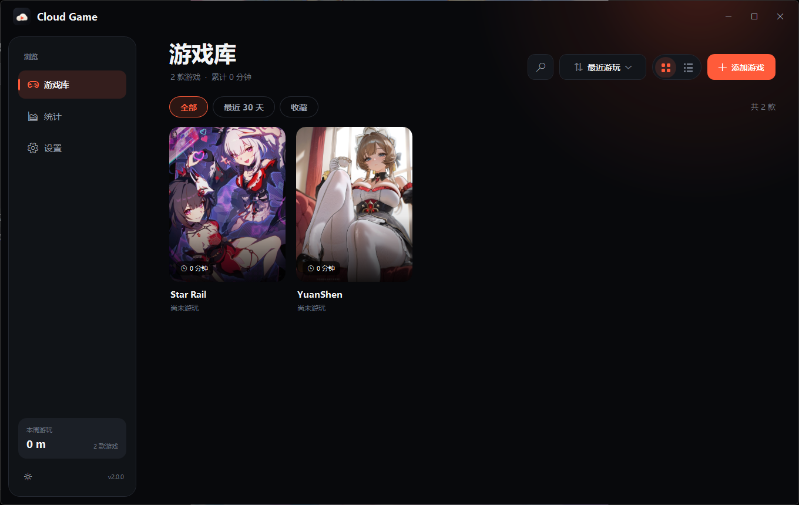
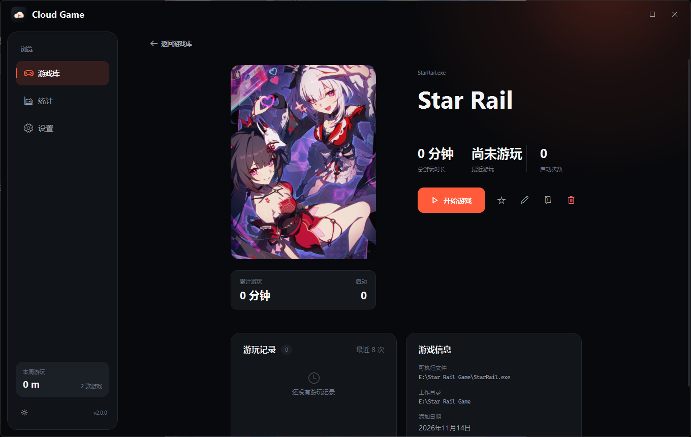
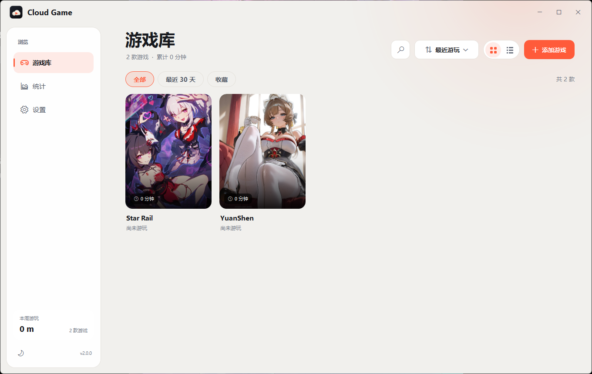
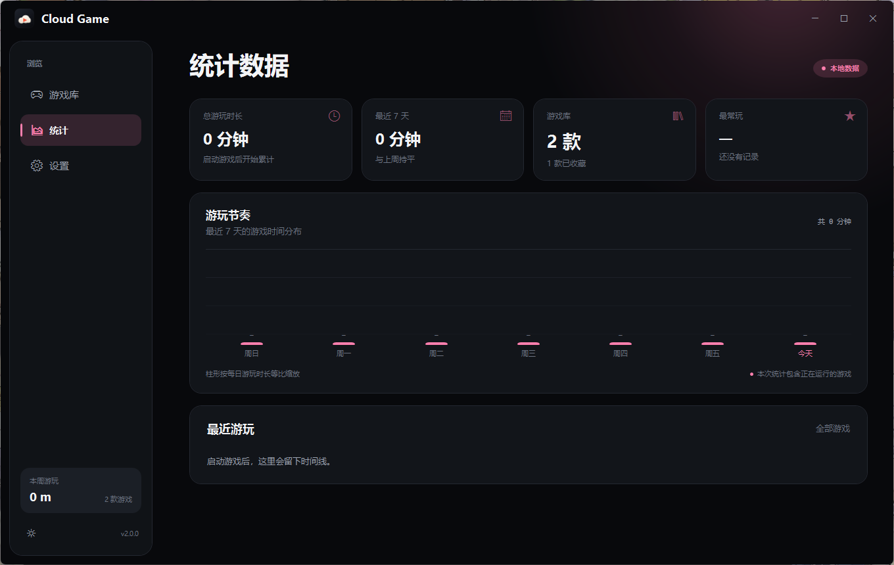
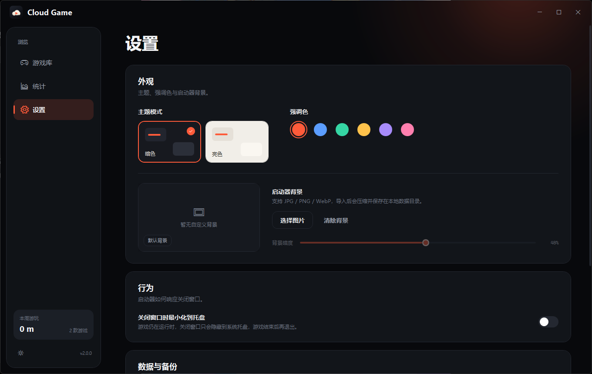
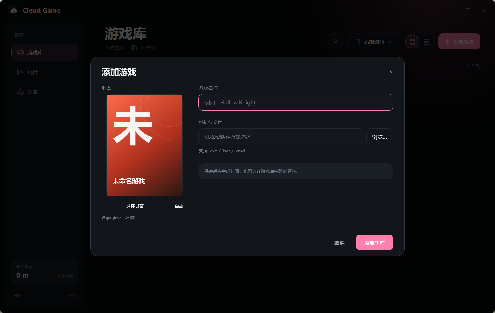
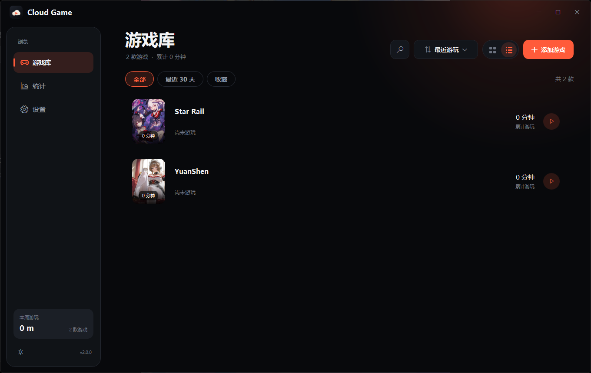

# Cloud Game

A lightweight local game library and launcher for Windows. Built with native **WPF / C#** — no Electron, WebView, or third-party runtime.

`CloudGame.exe` is a single **~288 KiB** executable. Current version: **2.0.0**.

[中文说明](README.md)



## Features

- **Local library** — add `.exe` / `.bat` / `.cmd` files, or drag them straight into the window.
- **Playtime tracking** — sessions, total playtime, last played, launch count, and live “running” indicators.
- **Custom covers** — choose an image for each game, or let Cloud Game generate procedural cover art.
- **Launcher background** — pick any image in Settings and adjust its dim level.
- **Themes** — dark / light modes and six accent colors, with animated transitions.
- **Import / export** — export play data only, or a full backup including covers, as a single JSON file.
- **Tray & shortcuts** — close to tray, then use the tray menu to open the app, add a game, open Settings, or quit. `Ctrl+F` focuses search; `Esc` closes details/dialogs.
- **Motion** — cover FLIP into details, page fades, list reflow, filter transitions, sidebar thumb, toast, and theme transitions.
- **Elevated games** — automatically retries through UAC when a game requires administrator rights.



## Requirements

- Windows 10 / 11 x64
- .NET Framework 4.8 (included with Windows 10 1903+ and Windows 11)
- No installation required — run `CloudGame.exe`

## Data location

Everything is stored locally:

```
%APPDATA%\CloudGame\
├── library.json      # games, play sessions, settings
├── media\            # covers and launcher background
└── error.log         # created only when an exception occurs
```

The import/export format is JSON with `format` set to `cloudgame.library`. Data from the old LUDENS version is not migrated automatically.

## Usage

1. Click **Add game**, or drag an `.exe` into the window.
2. Enter a name and executable; optionally choose a cover (leave empty to auto-generate one).
3. Click a card for details, or click the play button on the cover/right side of a list row to launch directly. Playtime is recorded automatically.
4. Use **Settings** to switch theme/accent, set a launcher background, or import/export data.

### Shortcuts

| Shortcut | Action |
| --- | --- |
| `Ctrl+F` | Open the library and focus search |
| `Esc` | Close details, editor, or confirmation dialog |

## Screenshots

| Dark | Light |
| --- | --- |
|  |  |

| Statistics | Settings |
| --- | --- |
|  |  |

| Add game | List view |
| --- | --- |
|  |  |

## Build from source

The project targets .NET Framework 4.0 and builds with the MSBuild included with Windows:

```powershell
C:\Windows\Microsoft.NET\Framework64\v4.0.30319\MSBuild.exe `
  .\Ludens.csproj `
  /p:Configuration=Release `
  /p:TargetFrameworkDirectory="C:\Windows\Microsoft.NET\Framework64\v4.0.30319"
```

Output: `bin\Release\CloudGame.exe`

## Project layout

```
Ludens.csproj           WPF project
App.xaml / App.xaml.cs  startup, themes, crash logging
MainWindow.xaml         window shell, sidebar, page switching, overlays
Views/                  Library / Detail / Stats / Settings / GameEditor / Confirm
Src/                    AppStore, LauncherService, MediaService, ThemeManager,
                        Motion, CoverArt, models
Resources/Styles.xaml   colors, typography, buttons, inputs, scrollbars, menus
Assets/                 icon and brand assets
docs/screenshots/       documentation screenshots
```

## Notes

- Playtime uses Windows Job Objects to track the process tree. If a game launches through a proxy process that exits immediately, timing may be inaccurate.
- Generated covers are procedural artwork and contain no copyrighted source material.
- Cloud sync is not included; all data stays on the local machine.
