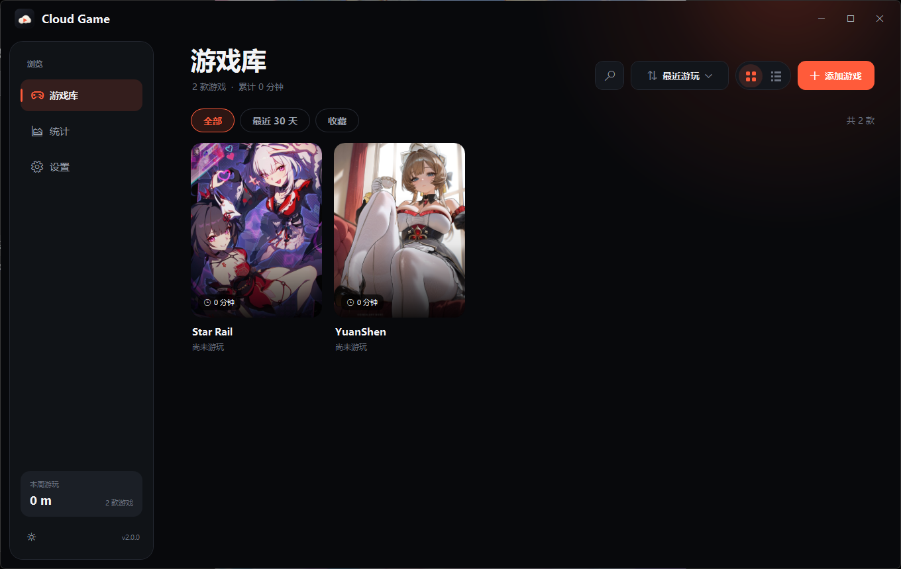
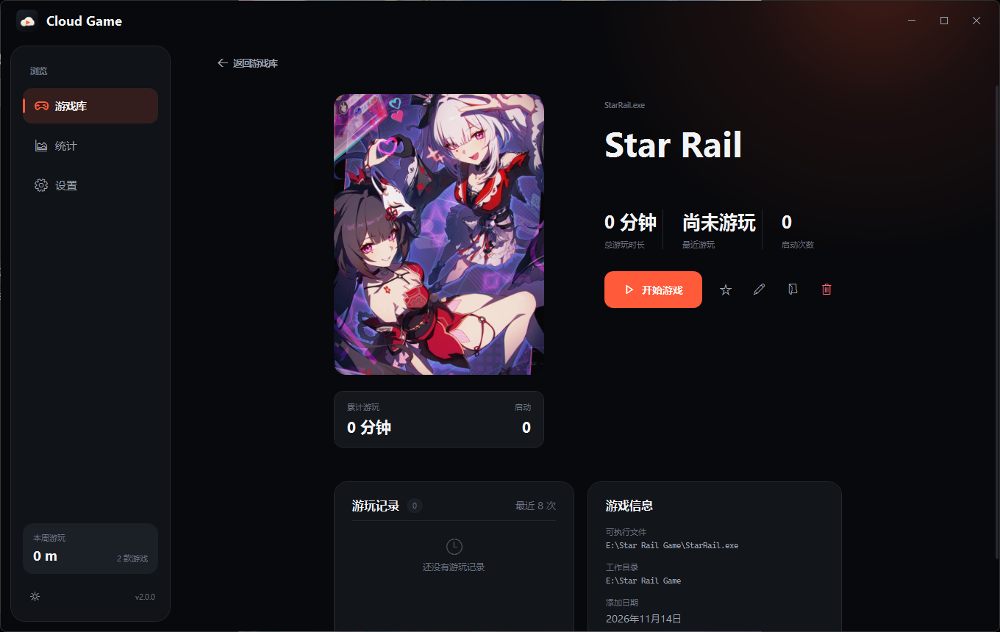
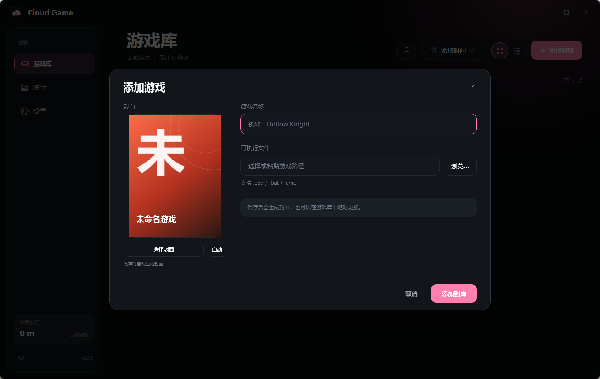

# Cloud Game

一个轻量的 Windows 本地游戏库与启动器。使用原生 **WPF / C#** 编写，不依赖 Electron、WebView 或第三方运行时。

使用 **.NET 8 WPF** 与零第三方 UI / MVVM 依赖重构；保留原有页面、布局、Windows 原生功能和本地数据格式。

[English README](README.en.md)



## 功能

- **本地游戏库**：添加 `.exe` / `.bat` / `.cmd`，也可以直接把文件拖进窗口。
- **游玩时长**：记录每次启动、单次会话、总时长、最近游玩和启动次数；运行中的游戏会实时显示。
- **自定义封面**：为每款游戏选择封面，或自动生成程序化艺术图。
- **启动器背景**：在设置中选择任意图片作为启动器背景，并调整暗化程度。
- **主题**：暗色 / 亮色模式，6 种强调色，切换时带整体过渡。
- **导出 / 导入**：支持只导出游玩数据，或连同封面一起导出为单个 JSON 文件。
- **托盘与快捷键**：关闭到托盘后，右键托盘图标可直接打开、添加游戏、进入设置或退出；`Ctrl+F` 聚焦搜索，`Esc` 关闭详情/弹窗。
- **动画**：封面飞入详情、页面淡入、列表重排、筛选切换、侧栏滑块、Toast 和主题过渡。
- **管理员游戏**：启动需要提升权限的游戏时，会自动通过 UAC 重试。



## 发布包

发布包位于 `release\CloudGame-2.1.0-win64.zip`；解压后运行所需的 framework-dependent .NET 8 文件约 **480 KB**，不包含系统已安装的 .NET 8 Desktop Runtime（完整 zip 还会包含中英文 README 与文档截图）。开发发布输出位于 `publish\win-x64\`。

## 环境

- Windows 10 / 11 x64
- .NET 8 Windows Desktop Runtime x64（开发机安装 .NET 8 SDK 即包含）
- framework-dependent 发布包无需安装应用本身，运行 `CloudGame.exe`

## 数据位置

所有数据保存在本地：

```
%APPDATA%\CloudGame\
├── library.json      # 游戏、游玩记录、设置
├── media\            # 封面、启动器背景
└── error.log         # 仅在出现异常时生成
```

导入/导出格式为 JSON，`format` 为 `cloudgame.library`。重构保留现有 `library.json` 与 `media\` 路径和 `DataContract` 数据契约；旧版本的 LUDENS 数据不会自动迁移。

## 使用

1. 点击“添加游戏”或把 `.exe` 拖进窗口。
2. 填写游戏名称、可执行文件，选择封面（也可以留空自动生成）。
3. 点击游戏卡片进入详情，或点击封面/列表右侧的播放按钮直接启动；启动器会记录本次游玩时长。
4. 在“设置”中切换主题、强调色、启动器背景，或导出/导入数据。

### 快捷键

| 快捷键 | 行为 |
| --- | --- |
| `Ctrl+F` | 打开游戏库并聚焦搜索 |
| `Esc` | 关闭详情 / 编辑弹窗 / 确认框 |

## 截图

| 暗色 | 亮色 |
| --- | --- |
|  |  |

| 统计 | 设置 |
| --- | --- |
|  |  |

| 添加游戏 | 横向列表 |
| --- | --- |
|  |  |

## 从源码构建

项目使用 SDK 风格的 .NET 8 WPF 工程。安装 .NET 8 SDK 后，在项目根目录执行：

```powershell
dotnet restore .\Ludens.csproj -r win-x64
dotnet build .\Ludens.csproj -c Release --no-restore
dotnet publish .\Ludens.csproj -c Release -r win-x64 --self-contained false `
  -o .\publish\win-x64 --no-restore
```

输出：`publish\win-x64\CloudGame.exe`

### 数据兼容性检查

此检查只读取 `%APPDATA%\CloudGame\library.json`，并验证 .NET 8 下的反序列化/往返序列化，不会改写用户数据：

```powershell
dotnet run --project .\tests\CloudGame.CompatibilityChecks\CloudGame.CompatibilityChecks.csproj -c Release
```

## 结构

```
Ludens.csproj           WPF 项目文件
App.xaml / App.xaml.cs  启动、主题、异常日志
MainWindow.xaml         窗口外壳、侧栏、页面切换、弹窗宿主
Views/                  Library / Detail / Stats / Settings / GameEditor / Confirm
Src/                    AppStore、LauncherService、MediaService、ThemeManager、
                        Motion、CoverArt、数据模型、零依赖 MVVM 基础设施
Src/ViewModels/         ShellViewModel（窗口命令；页面逻辑按阶段迁移）
tests/                  现有 library.json 的 .NET 8 兼容性检查
Resources/Styles.xaml   颜色、字体、按钮、输入框、滚动条、菜单样式
Assets/                 图标与品牌图
docs/screenshots/       README 截图
```

## 说明

- 游戏计时基于 Windows Job Object 跟踪进程树；如果游戏本身通过代理进程启动并很快退出，计时可能不准确。
- 自动生成的封面是程序化艺术图，不包含版权素材。
- 当前版本不包含云同步；数据只保存在本机。
